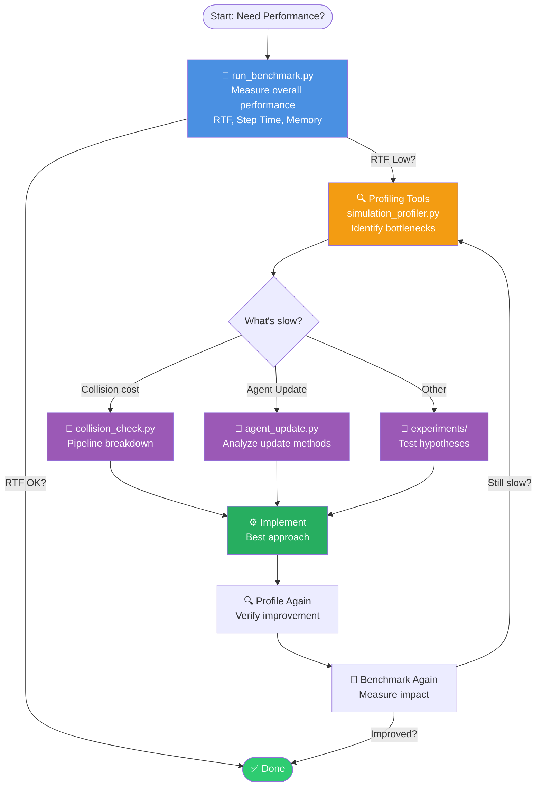

# PyBullet Fleet - Performance Benchmark Suite

This directory contains the benchmark scripts, profiling tools, experiment scripts, and configuration files for PyBulletFleet performance measurement and optimization. This file also renders as part of the project documentation on ReadTheDocs.

Last Updated: 2026-07-24

---

## Performance Optimization Workflow



### Typical Bottlenecks

| Symptom | Tool | Common Fix |
|---------|------|------------|
| Collision cost is significant | `collision_check.py` | Inspect the scene and reduce frequency or select a suitable collision mode |
| Agent Update > 40% | `agent_update.py` | Skip stationary agents, reduce PyBullet API calls |
| Goal setting > 100ms | `agent_manager_set_goal.py` | Cache trajectory calculations |
| Joint Update slow | `arm_joint_update.py` | Compare physics vs kinematic mode |

### Tool Categories

- 🎯 **Benchmarking:** `run_benchmark.py`, `mobile_benchmark.py`, `arm_benchmark.py` — measure overall performance (RTF, step time, memory)
- ⚡ **Controller comparison:** `run_benchmark.py --type mobile_control_path --controller ... --command-interface ...`, `batch_perf.py` — controller and command-interface timing with phase breakdown
- 🚚 **Steady state:** `run_benchmark.py --type steady --scenario sparse|dense|carrying|warehouse|idle`, `steady_bench.py` — per-phase step time of a window in which the whole fleet keeps moving (`make bench-steady` runs the reference set)
- 🔍 **Profiling:** `profiling/` — identify *what is slow* (see `profiling/README.md`)
- 🧪 **Experiments:** `experiments/` — compare *which is faster* (see `experiments/README.md`)

| | `profiling/` | `experiments/` |
|---|---|---|
| **Purpose** | Identify **what is slow** | Compare **which is faster** |
| **Scope** | Internal component breakdown | Algorithm / API alternative comparisons |
| **Output** | Time breakdown by component (%) | Method A vs Method B comparison table |

---

## Quick Start

```bash
# Mobile: single benchmark (1000 agents, 10s, 3 repetitions)
# Uses the default overall-performance path from benchmark/configs/general.yaml:
# batch controller + fleet command interface.
python benchmark/run_benchmark.py --agents 1000 --duration 10

# Mobile: multi-agent sweep
python benchmark/run_benchmark.py --sweep 100 500 1000 2000 5000

# Mobile: scenario comparison
python benchmark/run_benchmark.py --compare no_collision collision_10hz collision_3d_full --agents 1000

# Mobile controller and command-ingress comparison.
python benchmark/run_benchmark.py --type mobile_control_path \
  --controller per_agent batch --command-interface per_agent fleet --agents 1000 --steps 600
python benchmark/run_benchmark.py --type mobile_control_path \
  --controller batch --command-interface per_agent fleet --sweep 100 500 1000 2000 --steps 300
python benchmark/run_benchmark.py --type mobile_control_path \
  --controller batch --command-interface fleet --agents 1000 --steps 300 --collision-freq 0
python benchmark/batch_perf.py --agents 1000 --mode omni
python benchmark/batch_perf.py --agents 1000 --mode omni \
  --controller per_agent batch --command-interface per_agent fleet

# Arm: single benchmark (10 arms, physics mode)
python benchmark/run_benchmark.py --type arm --agents 10 --duration 5 --scenario physics

# Arm: sweep arm counts (physics + kinematic)
python benchmark/run_benchmark.py --type arm --sweep 1 10 50 100

# Identify bottleneck (mobile)
python benchmark/profiling/simulation_profiler.py --agents=1000 --steps=100

# Identify bottleneck (arm)
python benchmark/profiling/arm_joint_update.py --arms=10 --steps=100

# Drill into collision detection
python benchmark/profiling/collision_check.py --agents=1000

# Drill into agent update (mobile)
python benchmark/profiling/agent_update.py --agents=1000 --test=cprofile
```

---

## Reading Benchmark Results

The versioned result tables, test environment, and methodology are maintained
in {doc}`Benchmark Results Reference <results>`. Keep published numbers there
rather than duplicating them in this suite guide.

For the default mobile benchmark, RTF is the simulation-loop value
`duration / simulation_wall_s`. It measures only `run_simulation()` and excludes
process startup, PyBullet setup, spawning, command setup, warmup, cleanup, and
JSON aggregation. Use spawn time and command-setup time alongside RTF when
evaluating end-to-end benchmark-worker cost.

The default workload uses headless, kinematic `simple_cube` robots with the
`batch_omni` fleet controller and fleet command interface. The mobile worker
currently gives goals to half of the spawned agents. The
`moving_agents_ratio` and `max_moving_agents` entries in `general.yaml` are not
yet consumed by that worker.

The control-path benchmark is a separate fixed-step micro-benchmark. Its
default run uses differential controllers, collision checks at 60 Hz, five
warmup steps, and 600 measured steps. Supplying multiple `--controller` and
`--command-interface` values measures their Cartesian product; use its JSON
output when comparing every combination.

---

## Directory Structure

```
benchmark/
├── README.md                          # This file (overview + results)
│
├── tools.py                           # Shared benchmark helpers (system info, memory, cleanup)
│
├── configs/                           # Benchmark-specific YAML configurations
│   ├── general.yaml                   # General performance benchmark (default)
│   ├── collision_physics_off.yaml     # Physics OFF + closest_points (recommended)
│   ├── collision_physics_on.yaml      # Physics ON + contact_points
│   └── collision_hybrid.yaml          # Physics ON + hybrid mode
│
├── results/                           # JSON output files
│
├── mobile_benchmark.py                # Worker: mobile agent benchmark
├── arm_benchmark.py                   # Worker: arm robot benchmark
├── run_benchmark.py                   # Orchestrator: mobile, arm, and control-path runs
│
├── profiling/                         # Profiling tools → see profiling/README.md
│   ├── README.md
│   ├── simulation_profiler.py         # step_once() component breakdown
│   ├── collision_check.py             # Collision pipeline 4-stage analysis
│   ├── agent_update.py                # Agent.update() detailed analysis (mobile)
│   ├── arm_joint_update.py            # Arm joint update profiling (physics vs kinematic)
│   ├── agent_manager_set_goal.py      # set_goal_pose() profiling
│   ├── wrapper_overhead.py            # Wrapper overhead: PyBullet vs SimObject vs Agent
│   └── profiling_config.yaml          # Shared profiling configuration
│
├── experiments/                       # Experiment scripts → see experiments/README.md
│   ├── README.md
│   ├── collision_methods_config_based.py
│   ├── collision_method_comparison.py
│   └── collision_mode_comparison.py   # NORMAL_3D vs NORMAL_2D (deprecated) vs DISABLED
│
└── archive/                           # Deprecated tools (superseded scripts)
```

---

## Architecture: Worker + Orchestrator Pattern

### **Workers** (`mobile_benchmark.py`, `arm_benchmark.py`)
- Each executes a single benchmark test in a clean process
- Mobile worker: loads YAML config, spawns cube agents, runs simulation
- Arm workers: spawns arm robots with JointAction sequences (physics or kinematic)
- Both output JSON to stdout
- Process isolation ensures clean memory state between runs

The default mobile worker path is configured in `benchmark/configs/general.yaml`
as `agents.batch_controller: batch_omni` and `agents.command_interface: fleet`.
Override those fields in a scenario or custom config when you need the legacy
per-agent path for comparison. `--collision-freq` can override the config value
for mobile, arm, and mobile control-path runs.

### **Shared Helpers** (`tools.py`)
- `get_system_info()` — CPU, memory, OS detection
- `get_memory_info()` — RSS + tracemalloc measurement
- `force_cleanup()`, `cpu_time_s()`, `ensure_disconnected()`, `warmup_steps()`

### **Orchestrator** (`run_benchmark.py`)
- Spawns worker processes, aggregates results
- `--type mobile` (default): mobile agent benchmarks
- `--type arm`: arm robot benchmarks (supports `--scenario physics|kinematic`)
- `--type mobile_control_path --controller ... --command-interface ...`:
  separate comparison axes
  for controller implementation (`per_agent`, `batch`) and command interface
  (`per_agent`, `fleet`)
- **Modes:** Single Test · Sweep (multiple counts) · Compare (multiple scenarios)
- Computes statistics (median, mean, stdev) and generates comparison tables

### CLI Reference

```bash
# Mobile: single test
python benchmark/run_benchmark.py --agents 1000 --scenario no_collision

# Mobile: sweep
python benchmark/run_benchmark.py --sweep 100 500 1000 2000

# Mobile: compare scenarios
python benchmark/run_benchmark.py --compare no_collision collision_10hz --agents 1000

# Arm: single test
python benchmark/run_benchmark.py --type arm --agents 10 --scenario physics

# Arm: sweep (physics + kinematic)
python benchmark/run_benchmark.py --type arm --sweep 1 10 50 100

# Workers (direct, usually called by orchestrator)
python benchmark/mobile_benchmark.py --agents 1000 --duration 10 --scenario no_collision
python benchmark/arm_benchmark.py --agents 10 --duration 5 --scenario physics
```

**Output Files:**
- Mobile: `benchmark_results_<agents>agents_<duration>s.json`, `benchmark_sweep_<duration>s.json`
- Arm: `arm_results_<arms>arms_<duration>s.json`, `arm_sweep_<duration>s.json`
- Control path: `mobile_control_path_sweep_<steps>steps.json`,
  `mobile_control_path_<controllers>__<interfaces>_<agents>agents.json`

---

## Benchmark Configs

The mobile benchmark reads simulation settings from the `simulation:` mapping:

```yaml
simulation:
  target_rtf: 0.0             # Maximum speed (no sleep)
  physics: false              # Kinematic stepping
  timestep: 0.1               # Simulation seconds per step
  enable_time_profiling: true # Collect internal timing when requested
  log_level: WARN             # Quiet benchmark output
```

| Config | Physics | Detection Method | Collision Margin | Timestep |
|--------|---------|-----------------|-----------------|----------|
| `general.yaml` | OFF | — | — | 0.1 (10 Hz) |
| `collision_physics_off.yaml` | OFF | `closest_points` | 0.02 (2 cm) | 0.00417 (240 Hz) |
| `collision_physics_on.yaml` | ON | `contact_points` | 0.0 | 0.00417 (240 Hz) |
| `collision_hybrid.yaml` | ON | `hybrid` | 0.02 (2 cm) | 0.00417 (240 Hz) |

**Recommendation:** Start with `collision_physics_off.yaml` when a kinematic,
distance-based collision baseline fits the scenario. Measure the target scene
before treating it as the fastest or most appropriate production configuration.

### Scenarios (`general.yaml`)

Each config file can define named scenarios under a `scenarios:` key.  A scenario
overrides only the fields it specifies; everything else falls back to the top-level
defaults.  Pass a scenario name with `--scenario` or `--compare`:

| Scenario | Description |
|----------|-------------|
| `no_collision` | Collision disabled — isolates controller overhead |
| `collision_3d_full` | Full 3D collision every step |
| `collision_10hz` | 3D collision at 10 Hz |
| `stress_5k_agents` | 5 000 agents, single run |
| `per_agent` | Per-agent controllers, no collision — for batch comparison |
| `batch_omni` | BatchOmniController, no collision — for batch comparison |

> **Minimum step count:** `general.yaml` uses `timestep=0.1 s`.  With `--duration 5`
> only 50 steps are measured — a single GC pause can skew the mean 10×.  Use
> `--duration 30` (300 steps) or longer for stable results.

---

## Further Reading

- **Profiling Guide** (`profiling/README.md`) — Detailed tool documentation, measurement methods, troubleshooting
- **Experiments Guide** (`experiments/README.md`) — Algorithm and API comparison scripts
- **Optimization Guide** (`docs/benchmarking/optimization-guide.md`) — Parameter tuning, configuration examples, use case recommendations

**Last Updated:** 2026-07-24
